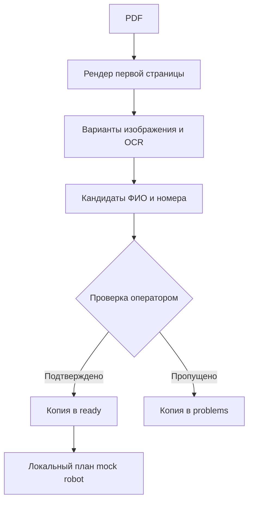

# Процесс обработки

В рабочем OCR Studio предусмотрены дополнительные шаблоны, проверка уверенности, пакетный интерфейс и робот внесения. Демо показывает публично воспроизводимый путь без рабочих URL, документов, реквизитов и сетевого внесения.
